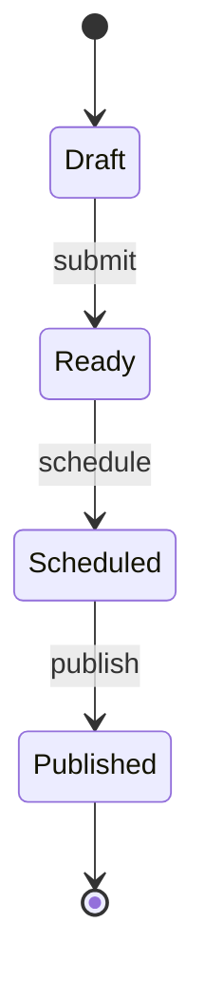

# Laravel Interlock

Interlock keeps an Eloquent model's state consistent with a transition graph you declare. The name comes from railways: an interlocking stops a signaller from setting conflicting routes, whichever lever they pull. Interlock does the same for model state. A model can't reach a state its machine doesn't allow, and two conflicting transitions can't both succeed.

State only changes through named transitions such as `ship`, `cancel` or `publish`. Assigning the attribute and saving throws. So do `update([...])`, `create([...])` in a state that isn't initial, and `Order::where(...)->update([...])`. Every transition writes with compare-and-swap, so when the state has changed since the model was loaded, the transition fails instead of overwriting it.

Transitions can also take typed input, check guards and authorisation, and write related rows in the same transaction, with follow-up work held back until it commits. Triggers apply a transition on their own once a condition holds. History, if you turn it on, records who changed what and why. You can export the machines to Mermaid for your docs, or to XState for the frontend.

Enforcement covers everything that goes through Eloquent. The query builder and raw SQL are outside it; see [Where enforcement stops](#where-enforcement-stops).

## Contents

- [Installation](#installation)
- [Defining a state machine](#defining-a-state-machine)
- [Applying transitions](#applying-transitions)
- [Guards, authorisation and actors](#guards-authorisation-and-actors)
- [Available transitions](#available-transitions)
- [Querying by state](#querying-by-state)
- [Enforcement](#enforcement)
- [Bypass](#bypass)
- [Triggers](#triggers)
- [History](#history)
- [Events](#events)
- [Exporting machines](#exporting-machines)
- [HTTP responses](#http-responses)
- [Discovery](#discovery)
- [Testing](#testing)

## Installation

Interlock requires PHP 8.4 or later and Laravel 12 or 13.

```bash
composer require robertboes/laravel-interlock
```

The service provider registers itself. Publishing the config file is optional:

```bash
php artisan vendor:publish --tag=interlock-config
```

History needs its table. Publish the migration and run it only if you turn history on for a machine:

```bash
php artisan vendor:publish --tag=interlock-migrations
php artisan migrate
```

The migration uses `morphs()` for the model and the actor. Change them to `uuidMorphs()` or `ulidMorphs()` before migrating if your models use UUID or ULID keys.

Interlock ships guidelines for [Laravel Boost](https://laravel.com/docs/boost). If your app uses Boost, `php artisan boost:install` (or `boost:update`) adds them to your AI assistant's instructions, so it changes state through transitions instead of writing the attribute.

## Defining a state machine

A state machine belongs to one state attribute of a model, such as `status`. Its states are the cases of a backed enum. Its transitions are named changes from one or more from-states to exactly one target state.

Start with the enum. Labels, colours and other behaviour can live on it as usual:

```php
enum OrderStatus: string
{
    case Pending = 'pending';
    case Preparing = 'preparing';
    case Shipped = 'shipped';
    case Delivered = 'delivered';
    case Cancelled = 'cancelled';
}
```

Then the machine. It declares its initial and final states as attributes and lists its transitions:

```php
use RobertBoes\Interlock\Attributes\FinalStates;
use RobertBoes\Interlock\Attributes\InitialStates;
use RobertBoes\Interlock\StateMachine;

#[InitialStates(OrderStatus::Pending)]
#[FinalStates(OrderStatus::Delivered, OrderStatus::Cancelled)]
class OrderStatusMachine extends StateMachine
{
    public function transitions(): array
    {
        return [
            $this->transition('prepare')->from(OrderStatus::Pending)->to(OrderStatus::Preparing),
            $this->transition('ship')->from(OrderStatus::Preparing)->to(OrderStatus::Shipped),
            $this->transition('deliver')->from(OrderStatus::Shipped)->to(OrderStatus::Delivered),
            $this->transition('cancel')->from(OrderStatus::Pending, OrderStatus::Preparing)->to(OrderStatus::Cancelled),
        ];
    }
}
```

Finally, link the machine to the model with `#[UseStateMachine]`, use the `HasStateMachines` trait and cast the state attribute to the enum. The cast is required:

```php
use Illuminate\Database\Eloquent\Model;
use RobertBoes\Interlock\Attributes\UseStateMachine;
use RobertBoes\Interlock\HasStateMachines;

#[UseStateMachine('status', OrderStatusMachine::class)]
class Order extends Model
{
    use HasStateMachines;

    protected function casts(): array
    {
        return [
            'status' => OrderStatus::class,
        ];
    }
}
```

The machine is compiled and checked the first time the model is used. A mistake in it, such as a transition without from-states or a target state, a parent state as a target, or two transitions with the same name, throws an `InvalidDefinitionException` that says what to fix. Discovery, triggers and exports also throw one for a model that declares `#[UseStateMachine]` but forgot the `HasStateMachines` trait, because nothing would enforce its machines.

### Initial and final states

Initial states are the states a model may be created in. When a machine has exactly one, Interlock fills it in on create, so `Order::create()` starts the order in `pending`. When it has several, the model has to be created with one of them; creating it without a state throws `AmbiguousInitialStateException`. Creating it in a state that is not initial throws `DirectWriteException`.

Initial states are declared on the machine rather than the enum, because one enum may back several machines.

Final states are where a model is meant to end up, so they have no outgoing transitions. Declaring them lets the [soundness check](#checking-machines-are-sound) tell an intended end from a dead end.

### Fluent and class-based transitions

A transition without input or logic takes one line, as above. The fluent builder also takes [guards](#guards), [authorisation](#authorisation), a [trigger](#triggers) and two steps:

```php
$this->transition('deliver')
    ->from(OrderStatus::Shipped)
    ->to(OrderStatus::Delivered)
    ->apply(fn(Order $order) => $order->delivered_at = now())
    ->afterCommit(fn(Order $order) => $order->customer->notify(new OrderDelivered($order))),
```

- `apply` runs inside the transition's transaction, after the state attribute is set to the target state and before the write. Attributes it sets are saved in the same update, and rows it writes are rolled back when the transition fails for any reason, stale state included.
- `afterCommit` runs once the transition has committed. Send mail, make HTTP calls and dispatch queued work here, so they never run for a transition that didn't happen. Inside an outer transaction, it waits for that transaction to commit. When it throws, the transition stays applied: its `Transitioned` event is still dispatched, and so are the `afterCommit` steps and events of the other transitions saved with it. The first exception is rethrown once they all have run.

A transition that needs input is a class with a typed constructor. Its from-states and target state are attributes, so exports and checks can read them without input values:

```php
use RobertBoes\Interlock\Attributes\FromStates;
use RobertBoes\Interlock\Attributes\TargetState;
use RobertBoes\Interlock\Transition;

#[FromStates(OrderStatus::Preparing)]
#[TargetState(OrderStatus::Shipped)]
final class Ship extends Transition
{
    public function __construct(public readonly string $trackingCode) {}

    public function apply(Order $order): void
    {
        $order->tracking_code = $this->trackingCode;
        $order->shipments()->create(['tracking_code' => $this->trackingCode]);
    }

    public function afterCommit(Order $order): void
    {
        $order->customer->notify(new OrderShipped($order));
    }
}
```

List the class in the machine's `transitions()`, next to the fluent ones:

```php
return [
    $this->transition('prepare')->from(OrderStatus::Pending)->to(OrderStatus::Preparing),
    Ship::class,
    // ...
];
```

Both steps are optional. The transition's name comes from its class name in snake case, so `Ship` is `ship` and `CreateLabel` is `create_label`. Override the static `name()` method to choose another.

### Nested states

A parent state groups child states in the same column, such as `preparing` grouping `packing` and `label_created`. Mark each child with `#[ParentState]`:

```php
use RobertBoes\Interlock\Attributes\ParentState;

enum OrderStatus: string
{
    case Pending = 'pending';
    case Preparing = 'preparing';
    #[ParentState(self::Preparing)]
    case Packing = 'packing';
    #[ParentState(self::Preparing)]
    case LabelCreated = 'label_created';
    case Shipped = 'shipped';
    case Delivered = 'delivered';
    case Cancelled = 'cancelled';
}
```

A model is never in a parent state itself, only in one of its children, so a parent state cannot be an initial state, a target state or a stored value. A transition from a parent state applies from any of its children: `cancel` from `Preparing` cancels a packing order and one with a label. The [state scopes](#querying-by-state) expand a parent state to its children, and `Interlock::isWithin($order->status, OrderStatus::Preparing)` tells you whether a state is nested within another.

### Guarded attributes

A guarded attribute is one that only named transitions may write, such as a `tracking_code` that only `ship` may set. Declare it on the machine, by transition name or class:

```php
use RobertBoes\Interlock\Attributes\GuardedAttribute;

#[GuardedAttribute('tracking_code', Ship::class)]
class OrderStatusMachine extends StateMachine
```

Writing a guarded attribute anywhere else throws, just like a direct write to the state attribute, and so does creating a model with it set. Writes to every other attribute stay unrestricted.

### Several machines on one model

Independent lifecycles get a machine each. Repeat `#[UseStateMachine]` once per state attribute:

```php
#[UseStateMachine('status', OrderStatusMachine::class)]
#[UseStateMachine('payment_status', PaymentStatusMachine::class)]
class Order extends Model
```

Transition names must be unique per model across all its machines, so applying a transition never needs to say which machine it belongs to. One enum may back several machines with different graphs, such as an `Approval` enum behind both `legal_status` and `finance_status`.

## Applying transitions

Apply a transition by name, or pass an instance of its class when it takes input:

```php
$order->transition('prepare');
$order->transition(new Ship($trackingCode));
```

A transition writes immediately; there is no separate `save()`. The model's other unsaved changes go out in the same update, so filling a form and applying a transition costs one query:

```php
$post->fill($request->validated())->transition('publish');
```

History and events still record only what the transition itself wrote. Eloquent's own model events (`saving`, `updating`, `updated`, `saved`) and timestamps fire as usual, so observers and search indexing keep working. A declared self-transition, from a state to itself, is applied like any other.

When a transition can't be applied, you get an exception that says why:

- `UnknownTransitionException`: the model has no transition with that name.
- `NotAFromStateException`: the current state isn't one of its from-states, as when a form is submitted twice. It renders as 409; its message only says the transition can't be applied in the record's current state, and the details are on its properties (`model`, `transition`, `stateAttribute`, `currentState`, `fromStates`) and in the context Laravel logs.
- `IllegalTransitionException`: you staged a second transition on a machine that already holds one.
- `MissingTransitionInputException`: you applied a class-based transition that takes input by name, instead of passing an instance.
- `CancelledTransitionException`: a `saving` or `updating` listener cancelled the save, so nothing was written. A `save()` that writes [staged transitions](#staged-transitions) returns `false` instead, like Eloquent's.

### Stale state

Every transition adds the state the model was loaded in to the `WHERE` clause of its update. If another request has changed the stored state in the meantime, the transition throws `StaleStateException`, writes nothing and rolls back whatever its `apply` step wrote. The model keeps its unsaved changes in memory, so you can reload and decide what to do:

```php
$a = Order::find($id);
$b = Order::find($id);

$a->transition('cancel');
$b->transition('prepare'); // throws StaleStateException
```

Its message only says the record changed and should be reloaded, because Laravel shows it in the 409 response. The details are on its properties (`model`, `transition`, `stateAttribute`, `loadedState`, `storedState`, `rowDeleted`) and in the context Laravel logs when it reports the exception.

Interlock does not take locks itself. Lock the row yourself with `lockForUpdate()` when you would rather wait than fail.

### Staged transitions

To write transitions on several machines and other changes in one update, stage them and save once:

```php
$order->stageTransition(new Ship($trackingCode))
    ->stageTransition('capture_payment')
    ->save();
```

Staging only checks the graph, so it fails straight away when the current state isn't a from-state, and from then on the state attribute reads the target state. Everything else waits for `save()`: authorisation, guards, the `apply` step and the compare-and-swap write, all checked against the data as it will be stored. Each machine holds one staged transition at a time; staging a second on the same machine throws. `discardStagedTransitions()` drops them and puts the state attributes back, and so does `refresh()`.

## Guards, authorisation and actors

A guard says "not now", authorisation says "not you". They throw different exceptions, so an API can tell them apart.

### Guards

A guard is a condition on the model that must hold for the transition to apply, such as "stock is available". It sees the model's unsaved changes, so it checks the model as it will be stored. Fluent transitions take a name, a check and a message:

```php
$this->transition('publish')
    ->from(PostStatus::Ready)
    ->to(PostStatus::Published)
    ->guard('has_title', fn(Post $post) => filled($post->title), 'A post needs a title before it is published.'),
```

A class-based transition marks its guard methods with `#[Guard]`. Each is named after its method in snake case, so `inStock()` is `in_stock`:

```php
use RobertBoes\Interlock\Attributes\Guard;

#[Guard('Not every item is in stock.')]
public function inStock(Order $order): bool
{
    return $order->items->every->inStock();
}
```

A failing guard throws `FailedGuardException` with the guard's message, which renders as 422. Guards run inside the transaction, before `apply`.

### Authorisation

A transition may say who may apply it, either as a closure or method that receives the actor and the model and returns a bool or a Gate response, or as the name of a Gate ability:

```php
$this->transition('reject')
    ->from(ExpenseStatus::Submitted)
    ->to(ExpenseStatus::Rejected)
    ->authorise(fn(?User $actor, Expense $expense) => $actor?->isManager() === true),

$this->transition('withdraw')
    ->from(ExpenseStatus::Submitted)
    ->to(ExpenseStatus::Draft)
    ->authorise('withdraw-expense'),
```

A class-based transition defines an `authorise(?User $actor, Expense $expense)` method, or names a Gate ability with `#[Authorise('approve-expense')]` on the class. Declare one or the other, not both. A transition without authorisation may be applied by every actor, a null actor included.

A denied actor gets `UnauthorisedTransitionException`. It extends Laravel's `AuthorizationException`, so it renders as 403 and your existing handling of authorisation failures applies. Authorisation is checked before the transaction begins.

### Actors

The actor is the user a transition is applied on behalf of. It defaults to the authenticated user. Jobs and commands can pass one explicitly, or pass `null` to act on behalf of no one:

```php
$expense->transition('approve', $manager);
$expense->transition('approve', null);
```

A null actor means no user, such as a guest, and authorisation still decides for it. A Gate ability whose callback takes a non-nullable user denies a null actor, as Laravel's Gate does for guests.

[Triggers](#triggers) are different: a trigger applies its transition without an actor and without checking its authorisation. Declaring the trigger is your decision that the system may apply the transition, so there is no user to ask about. Its guards still run, and history records the trigger's name with no actor.

## Available transitions

`availableTransitions()` returns the transitions an actor can apply to the model right now, across all its machines: those whose from-states include the current state, whose guards pass and whose authorisation allows the actor. Nothing is written and no events are dispatched.

```php
$order->availableTransitions();          // for the authenticated user
$order->availableTransitions($manager);  // for a given actor
$order->availableTransitions(null);      // on behalf of no one
```

Each one serialises as its name, the state attribute of the machine it belongs to and its target state, ready for an API resource or Inertia props:

```json
[
    {"name": "ship", "state_attribute": "status", "target_state": "shipped"},
    {"name": "cancel", "state_attribute": "status", "target_state": "cancelled"},
    {"name": "authorise_payment", "state_attribute": "payment_status", "target_state": "authorised"}
]
```

A transition that takes input is offered on its from-states and authorisation alone, because its guards may read input that only exists once it is applied. Its `authorise()` method must not read that input.

## Querying by state

Interlock ships tappable scope classes. They add no methods to your models and no global macros:

```php
use RobertBoes\Interlock\Scopes\InFromStateOf;
use RobertBoes\Interlock\Scopes\InState;
use RobertBoes\Interlock\Scopes\NotInState;

Order::query()->tap(new InState(OrderStatus::Preparing))->get();
Order::query()->tap(new NotInState([OrderStatus::Delivered, OrderStatus::Cancelled]))->get();
Order::query()->tap(new InFromStateOf('ship'))->get();
```

`InState` and `NotInState` expand a parent state to its children, so "all preparing orders" includes the packing ones. They find the state attribute from the enum; pass it as `stateAttribute` when one enum backs several machines on the model: `new InState(Approval::Approved, stateAttribute: 'legal_status')`.

`InFromStateOf` finds the models in a from-state of the transition. It does not evaluate guards or authorisation; ask the model for its [available transitions](#available-transitions) when those matter.

The scopes also work as eager-load constraints, with `with()` and `load()`:

```php
Customer::with(['orders' => new InState(OrderStatus::Preparing)])->get();
$customer->load(['orders' => new InFromStateOf('ship')]);
```

If you prefer Eloquent scope methods, add the opt-in `HasStateScopes` trait to the model:

```php
use RobertBoes\Interlock\HasStateScopes;

Order::whereInState(OrderStatus::Preparing)->get();
Order::whereNotInState(OrderStatus::Cancelled)->get();
Order::whereInFromStateOf('ship')->get();
```

## Enforcement

A direct write is any change to a state attribute or guarded attribute that doesn't go through a transition. Interlock rejects it with `DirectWriteException` and writes nothing. That covers:

- assigning the attribute and calling `save()`, or passing it to `update()` or `fill()` and saving;
- `create()` and `insert` in a state that is not an initial state, or with a guarded attribute set;
- `saveQuietly()`, `updateQuietly()`, `createQuietly()` and `Model::withoutEvents()`, because enforcement does not depend on model events;
- mass writes through the Eloquent builder: `update`, `updateFrom`, `updateOrInsert`, `upsert`, `increment`, `decrement`, `incrementEach`, `decrementEach`, `insert`, `insertOrIgnore`, `insertOrIgnoreReturning` and `insertGetId`, whenever they touch a state attribute or guarded attribute, and `insertUsing` and `insertOrIgnoreUsing` whenever their columns include one, since the values a subquery selects are not known up front.

There is no setting that turns enforcement off. The only way past it is a [bypass](#bypass), which needs a reason. Deletes, force deletes and restores are not governed; that is what policies are for.

### Where enforcement stops

**Everything that goes through Eloquent is enforced. `DB::table()`, `toBase()` and raw SQL are not.** These write to the database without passing through the model or its Eloquent builder, so Interlock never sees them:

```php
DB::table('orders')->where('id', $id)->update(['status' => 'shipped']);   // not enforced
Order::query()->toBase()->update(['status' => 'shipped']);               // not enforced
DB::statement("update orders set status = 'shipped' where id = ?", [$id]); // not enforced
```

Interlock is not a database constraint. A database backstop that blocks these writes too is planned for a later version; until then, keep state changes on the Eloquent path and treat these routes the way you would treat editing the table by hand.

### Custom Eloquent builders

Interlocked models get Interlock's own Eloquent builder, which is what rejects mass writes. If a model already has a custom builder, add the `RejectsDirectWrites` trait to it:

```php
use Illuminate\Database\Eloquent\Builder;
use RobertBoes\Interlock\RejectsDirectWrites;

class OrderBuilder extends Builder
{
    use RejectsDirectWrites;
}
```

An interlocked model whose custom builder lacks the trait throws `MissingBuilderTraitException` as soon as it builds a query, to read, save or mass write, so enforcement is never lost silently. Making an instance doesn't check it, so `new Order()` needs no database connection.

### `replicate()` starts the lifecycle over

**This differs from Laravel's default.** Laravel's `replicate()` copies every attribute. On an interlocked model, the copy instead starts its lifecycle over: each state attribute is reset to its machine's initial state, or left null when the machine has several, and every guarded attribute is cleared. Without that, saving a copy of a shipped order would be a direct write to `shipped` and would throw.

```php
$copy = $shippedOrder->replicate();

$copy->status;        // OrderStatus::Pending
$copy->tracking_code; // null
```

A `replicating` listener may still set a state attribute on the copy; it is only reset when the listener leaves it unset.

## Bypass

Seeders, imports and data fixes sometimes need to set any state. Run them inside a bypass, with a reason:

```php
use RobertBoes\Interlock\Interlock;

Interlock::bypass('Import orders from the old shop', function () use ($rows) {
    foreach ($rows as $row) {
        Order::create([
            'reference' => $row['reference'],
            'status' => OrderStatus::from($row['status']),
        ]);
    }
});
```

The reason is required, so the audit trail says why and not just that something changed. The bypass covers model saves and mass writes through the Eloquent builder, and it ends when the callback returns or throws, so it can never stay on by accident. `bypass()` returns whatever the callback returns.

A bypassed write to a state attribute dispatches `BypassedWrite` with the reason. A bypassed write to a guarded attribute dispatches `BypassedGuardedAttributeWrite`, which also carries the attribute's old and new value. If the machine records [history](#history), both end up there. A bypassed mass write dispatches `BypassedMassWrite` instead. It names the model class and the attributes written, but not the rows (the query picks those), so it isn't recorded in history.

## Triggers

A trigger applies a transition on its own once a condition holds, such as "`publish_at` has passed". Declare it on the transition as a constraint on the model's query:

```php
use Illuminate\Database\Eloquent\Builder;

$this->transition('publish')
    ->from(PostStatus::Ready)
    ->to(PostStatus::Published)
    ->trigger(fn(Builder $query) => $query->where('publish_at', '<=', now())),
```

The condition can be any callable that takes the query, so a tappable scope class your app already uses works as it is:

```php
->trigger(new PublishAtHasPassed()),
```

The transition's from-states are added to the condition, so it only says what is specific to the trigger. A class-based transition declares a static `trigger()` method instead:

```php
public static function trigger(Builder $query): void
{
    $query->where('payment_status', PaymentStatus::Unpaid)->where('created_at', '<=', now()->subDays(3));
}
```

A transition that takes input cannot be built by name, so it cannot have a trigger: a transition class whose constructor has required parameters and declares `trigger()` throws `InvalidDefinitionException` when its graph is compiled.

Scheduling means setting the data the condition reads, never storing a pending run. To reschedule a post, change `publish_at`. To stop it, move it back to draft. Nothing needs cancelling.

### Running triggers

**Triggers only run while the Laravel scheduler runs.** Interlock registers `interlock:triggers` to run every minute, so make sure your server runs `php artisan schedule:run` every minute (or `php artisan schedule:work` locally). Without it, no trigger ever fires.

Two config keys change that:

- `interlock.triggers.schedule.cron` (default `* * * * *`): how often the command runs.
- `interlock.triggers.schedule.enabled` (default true): set it to false to schedule `interlock:triggers` yourself, for example on one server only or with your own overlap and output options.

The command does no querying itself. It dispatches one queued job per trigger, so a large backlog never slows the scheduler down, and a queue worker must be running to process them. The jobs go to the app's default queue connection and queue; `interlock.triggers.connection` and `interlock.triggers.queue` send them elsewhere, such as a queue with its own workers so a big backlog doesn't hold up other work. Each job is unique per trigger, so a slow run and the next one never work on the same trigger at once; this needs a cache store that supports locks, as Laravel's unique jobs do. When a job can't be dispatched, say because the queue is down, the command reports it, dispatches the other triggers, and exits with a failure; the next run tries that trigger again.

The job applies the transition to each matching model, a chunk at a time in key order, without an actor and without checking its authorisation, and records the trigger's name in history. Its guards still run. Three config keys size it:

- `interlock.triggers.chunk_size` (default 100): how many models it loads at a time.
- `interlock.triggers.max_per_run` (default 1000): the most models one run handles. A bigger backlog drains over the next runs, each carrying on where the last stopped, even when the last died partway: the run saves its place after every chunk.
- `interlock.triggers.timeout` (default 60): the seconds one job may run. **Keep it below the `retry_after` of the queue connection** (90 by default), or the queue hands a slow run to a second worker while the first is still working on it. A job stops taking on models once three quarters of its timeout has passed, and the next run carries on from there. A job that runs out of time anyway is failed, not run again.

A busy trigger can fan out into one job per chunk, so it can use several queue workers. Pass `fanOut: true` to the fluent `trigger()`, or mark a class-based transition's `trigger()` method with `#[FanOut]`:

```php
->trigger(fn(Builder $query) => $query->where('publish_at', '<=', now()), fanOut: true),
```

The next run of a fanned-out trigger does nothing until every chunk job of the last one has finished or failed. Should one never report back, the trigger runs again once each chunk job could have used up its timeout in turn, or after five minutes, whichever is later.

Each chunk job carries its chunk's keys in its payload. With UUID or ULID keys, an `interlock.triggers.chunk_size` of around 5,000 exceeds the 256 KB message limit of SQS, so keep chunks of fanned-out triggers in the hundreds there.

Queue workers keep running the code they booted with, so run `php artisan queue:restart` after a deploy that adds, renames or removes a trigger. A trigger job still queued for a transition that was removed, or lost its trigger, does nothing.

A model whose state changed since it was loaded, or whose guard fails, is skipped quietly. Any other exception is reported and the run carries on with the rest. Either way the model still matches the condition, so the next run picks it up again. There are no retries, and nothing to clean up. A lost database connection is the exception: it fails the job instead of being reported once per model, and the next run tries again. Authorisation can't stop a trigger; to stop it, change or remove the trigger, or add a guard.

### The "scheduled and locked" pattern

A plain trigger leaves the model editable until the moment it fires: a ready post can still be retracted or published by hand. When a scheduled change must not be touched any more, model the lock as its own state whose only way out is the triggered transition:

```php
#[InitialStates(PostStatus::Draft)]
#[FinalStates(PostStatus::Published)]
#[GuardedAttribute('publish_at', 'schedule')]
class PostStatusMachine extends StateMachine
{
    public function transitions(): array
    {
        return [
            $this->transition('submit')->from(PostStatus::Draft)->to(PostStatus::Ready),
            $this->transition('schedule')->from(PostStatus::Ready)->to(PostStatus::Scheduled),
            $this->transition('publish')
                ->from(PostStatus::Scheduled)
                ->to(PostStatus::Published)
                ->trigger(fn(Builder $query) => $query->where('publish_at', '<=', now())),
        ];
    }
}
```

```php
$post->publish_at = $request->date('publish_at');
$post->transition('schedule');
```

Once scheduled, no transition but `publish` leaves `scheduled`, and only `schedule` may write `publish_at`, so neither the state nor the time can change until the trigger publishes the post. The lock shows up in the graph and in the exports, rather than hiding in a flag. To allow unlocking, add a transition out of `scheduled`, such as `unschedule` back to `ready`. `publish` itself can still be applied by hand; to leave it to the trigger alone, authorise it for no one with `->authorise(fn() => false)`. The trigger still applies it, as triggers don't check authorisation. Don't authorise only the null actor, `$actor === null`, to mean "only the trigger": a guest is a null actor too, so any code a guest can reach could apply it, and `availableTransitions()` would offer it to guests.

## History

History is opt-in per machine. Publish and run the [migration](#installation), then add `#[RecordsHistory]` to the machine:

```php
use RobertBoes\Interlock\Attributes\RecordsHistory;

#[RecordsHistory]
class OrderStatusMachine extends StateMachine
```

Without the migration, the machine's first transition throws a `MissingHistoryTableException` that names the machine and says how to fix it.

Every transition and every bypassed write on that machine's state attribute or guarded attributes is then recorded in the `interlock_history` table, inside the same transaction as the write, so history can never disagree with the stored state. Quiet saves are recorded too. Each entry holds:

- the model's type and key, and the state attribute;
- the transition's name, null for a bypassed write;
- the from-state and target state, as their backing values;
- the actor's type and key, null when there was none;
- the attributes the transition or bypassed write wrote, old and new, and not the model's other changes;
- the bypass reason, the trigger that applied it, and a timestamp.

Read a model's history through its relationship, optionally for one state attribute. Entries in the same second share a timestamp, so order a timeline by key:

```php
$order->history()->get();
$order->history('status')->oldest('id')->get();
```

Each entry is a `RobertBoes\Interlock\History\HistoryEntry` model, with `model` and `actor` relationships.

To write history somewhere else, implement `RobertBoes\Interlock\History\HistoryRecorder` and name your class in `interlock.history.recorder` (default `DatabaseHistoryRecorder`). It is resolved from the container, and called inside the write's transaction, so throwing rolls the write back. Binding the interface in a service provider works too, and wins over the config:

```php
use RobertBoes\Interlock\History\HistoryRecorder;

$this->app->singleton(HistoryRecorder::class, MyHistoryRecorder::class);
```

## Events

Interlock dispatches ordinary Laravel events, not model events, so muting Eloquent events doesn't mute them:

| Event | When |
| --- | --- |
| `RobertBoes\Interlock\Events\Transitioning` | Inside the transaction, after the `apply` step and before the write |
| `RobertBoes\Interlock\Events\Transitioned` | After the transaction commits, once the `afterCommit` step has run |
| `RobertBoes\Interlock\Events\BypassedWrite` | After a direct write to a state attribute that a bypass allowed |
| `RobertBoes\Interlock\Events\BypassedGuardedAttributeWrite` | After a direct write to a guarded attribute that a bypass allowed |
| `RobertBoes\Interlock\Events\BypassedMassWrite` | After a mass write through the builder that a bypass allowed |

`Transitioning` and `Transitioned` carry the model, the transition's name, the from-state and the target state.

The events that carry a model serialise it the way Laravel's queued jobs do, by its key. A queued listener gets the model as it is stored when the listener runs, fetched fresh from the database, not a snapshot of the instance that dispatched the event. If the model was deleted in the meantime, the listener's job fails with a `ModelNotFoundException`.

## Exporting machines

The `interlock:signalbox` command exports your machines, every registered one or a single one, as Mermaid or XState:

```bash
# Every machine, as Mermaid diagrams in one Markdown document
php artisan interlock:signalbox

# One machine
php artisan interlock:signalbox "App\StateMachines\OrderStatusMachine"

# XState v5 config as JSON, for the Stately visualiser
php artisan interlock:signalbox --format=xstate

# XState as TypeScript with literal types, written to a file for the frontend
php artisan interlock:signalbox --format=xstate-ts --output=resources/js/machines.ts
```

| Format | Output |
| --- | --- |
| `mermaid` (default) | A `stateDiagram-v2`, with parent states as composite states |
| `xstate` | XState v5 machine config JSON |
| `xstate-ts` | The same config as TypeScript, plus state and event types |

In the XState export, transitions are events, parent states are nested states and final states are `type: 'final'`. Guards appear by name only, so no server logic leaks, and triggered transitions carry `meta: { trigger: true }`. A machine's XState ID is its class name without the namespace, so exporting every machine as XState fails when two machines share a class name; rename one, or export them one at a time. The Mermaid export of the locked post machine above looks like this:



## HTTP responses

Every Interlock exception implements `RobertBoes\Interlock\Exceptions\InterlockException`, so you can catch or report them as a group. Uncaught, they render like this:

| Exception | Status | Meaning |
| --- | --- | --- |
| `UnauthorisedTransitionException` | 403 | The actor may not apply the transition (or the status a denying Gate response gave) |
| `FailedGuardException` | 422 | A guard failed; the body's `message` is the guard's message |
| `StaleStateException` | 409 | The stored state changed since the model was loaded; reload and retry |
| `NotAFromStateException` | 409 | The current state isn't one of the transition's from-states, as when a form is submitted twice |
| `DirectWriteException`, `IllegalTransitionException`, `UnknownTransitionException`, `InvalidDefinitionException`, `MissingBuilderTraitException`, and the rest | 500 | A programming error to fix, not something to show users |

Override any of them the usual Laravel way, in `bootstrap/app.php`:

```php
use RobertBoes\Interlock\Exceptions\FailedGuardException;

->withExceptions(function (Exceptions $exceptions) {
    $exceptions->render(fn(FailedGuardException $e) => response()->json([
        'message' => $e->getMessage(),
        'errors' => ['transition' => [$e->getMessage()]],
        'guard' => $e->guard,
    ], 422));
})
```

This keeps Laravel's 422 validation shape and adds the guard's name. Clients should match on the guard name, which stays the same, not on the message text, which you may reword or translate. `FailedGuardException` also carries the `model` and the `transition` name.

## Discovery

Triggers, exports and the soundness check need to know every interlocked model, so Interlock finds them by scanning for `#[UseStateMachine]`. That way a trigger never silently fails to run for a model you forgot to register.

- `interlock.discovery.paths` lists the directories it scans, recursively. The default is `app/Models`.
- `interlock.models` lists models outside those paths, such as models from packages or modules. A package's service provider can add its own from its `boot` method with `Interlock::registerModels(Invoice::class)`.

In production, cache the result with `php artisan interlock:cache`. It runs as part of `php artisan optimize`, and `php artisan interlock:clear` (part of `optimize:clear`) removes it.

## Testing

### Factories

Models created through Eloquent factories bypass enforcement automatically, with the reason "factory", so a test can create a model in any state in one line:

```php
$order = Order::factory()->create(['status' => OrderStatus::Shipped]);
```

Everything else in your tests stays enforced, so endpoint tests still catch illegal transitions. A model a factory only made, and that your code saves later, is enforced as usual.

To opt a single test into a full bypass, call `Interlock::bypassForTest()`. It lasts until the test ends and is refused outside tests:

```php
it('imports legacy orders', function () {
    Interlock::bypassForTest('legacy fixtures');

    // ...
});
```

### Checking machines are sound

One assertion checks every registered machine for states that cannot be reached from an initial state, states without a way out that are not final, final states with outgoing transitions, and definitions the graph rejects, such as duplicate transition names. It reports every problem at once:

```php
use RobertBoes\Interlock\Interlock;

it('has sound state machines', function () {
    Interlock::assertMachinesAreSound();
});
```

Pass model classes to check only those: `Interlock::assertMachinesAreSound(Order::class)`. Under Pest, the same check is an expectation:

```php
expect(Interlock::models())->toHaveSoundStateMachines();
expect(Order::class)->toHaveSoundStateMachines();
```

### Asserting on transitions

Assert that code transitioned a model, applied through that instance or any other instance of the same row:

```php
Interlock::assertTransitioned($order, 'ship');
Interlock::assertNotTransitioned($order, 'cancel');
Interlock::assertNotTransitioned($order); // no transition at all
```

Only transitions that committed count. A misspelt transition name throws, so it can't make `assertNotTransitioned()` pass by accident.

### Faking transitions

`Interlock::fake()` skips the `apply` and `afterCommit` steps of every transition for the rest of the test, to test the code that applies them in isolation:

```php
Interlock::fake();

$this->post("/orders/{$order->id}/ship", ['tracking_code' => 'TRACK-1']);

Interlock::assertTransitioned($order, 'ship');
```

Faked transitions skip their guards and authorisation too. They still check their from-states, write their target state with the model's other changes and dispatch their events, so an illegal transition still throws.

## License

The MIT License (MIT). See [LICENSE.md](LICENSE.md).
